# Showreel 2026, edited by the music

<p align="center">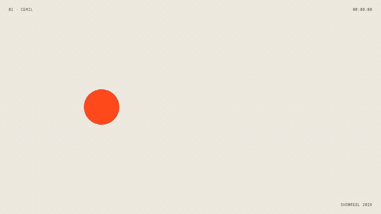</p>

<p align="center"><b><a href="https://lalimec.github.io/showreel-code/">▶ Watch the reel with its data running underneath</a></b><br>
or switch that page to <i>Live code, no media</i>: the same React code from this repo, playing in your browser.</p>

The source code of my 2026 showreel: a 70-second edit written in Remotion (React), where the music decides the timing. Every cut, type change, zoom and grid step sits on a musical event read from data files. Nothing is keyframed by hand.

The repository holds the code and the data. The media isn't included: the AI clips, tool screenshots and gameplay recordings are partly private work material. The watch page plays the rendered reel with its music, next to the same code running live.

The repository still renders as it is. Without the media, every slot is drawn as a labelled placeholder, and everything around the slots comes from the same data. See [Run it yourself](#run-it-yourself).

<table>
<tr>
<td>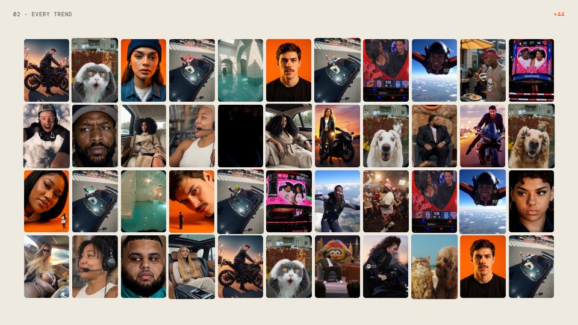</td>
<td>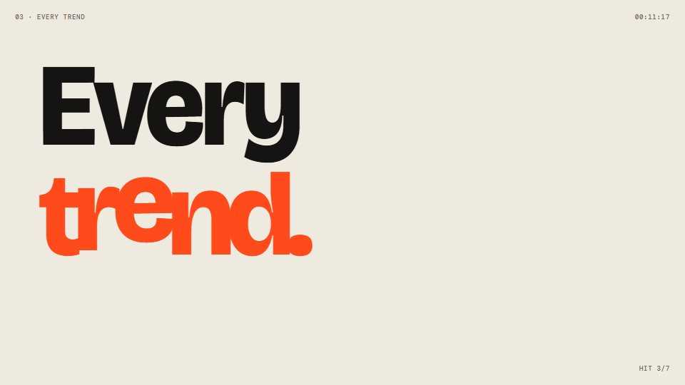</td>
<td>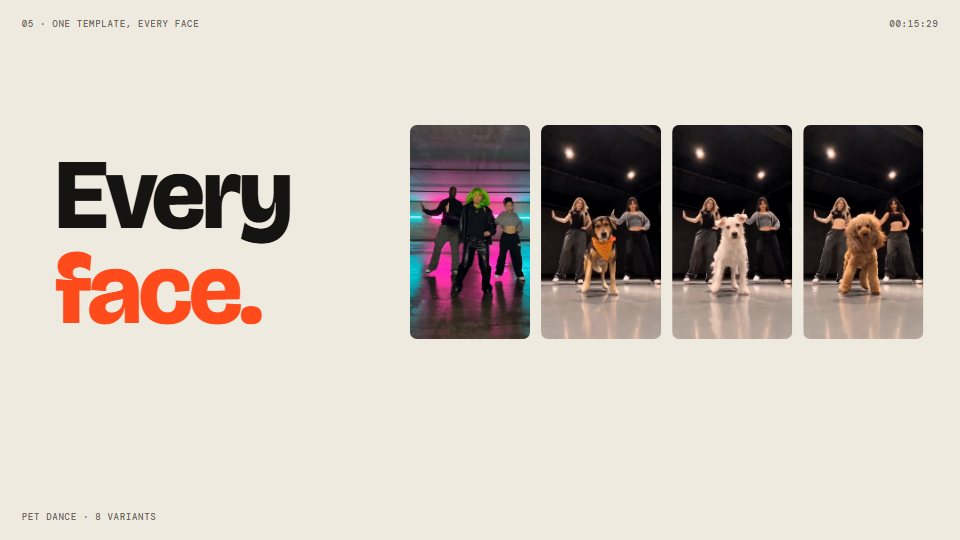</td>
</tr>
<tr>
<td>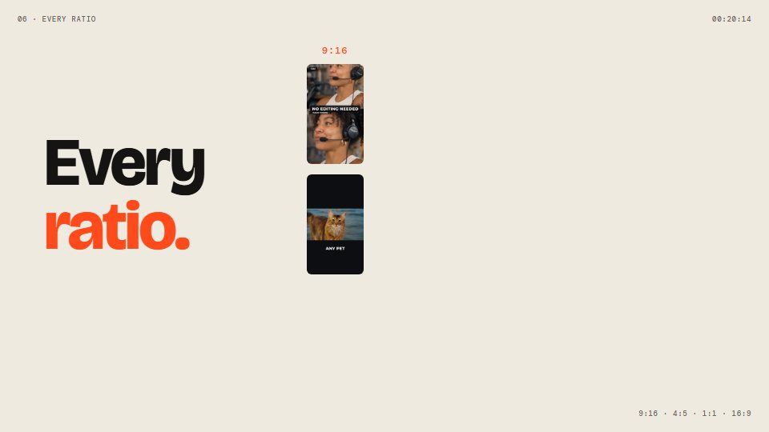</td>
<td>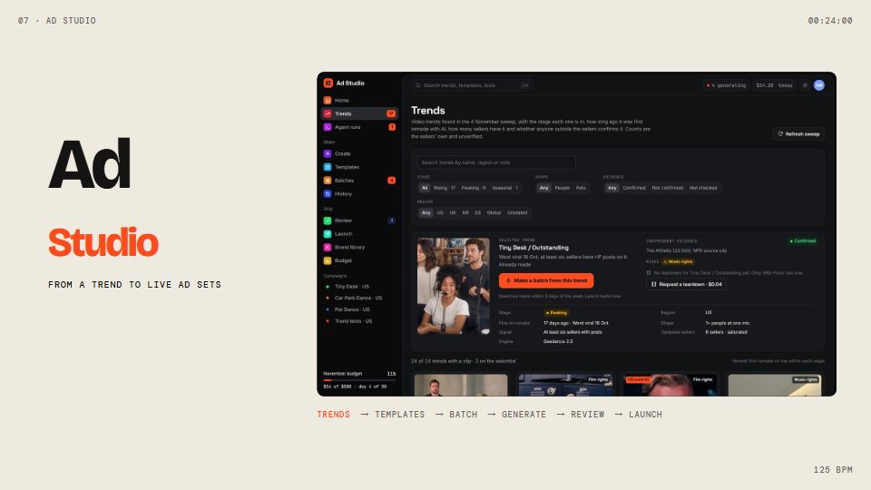</td>
<td>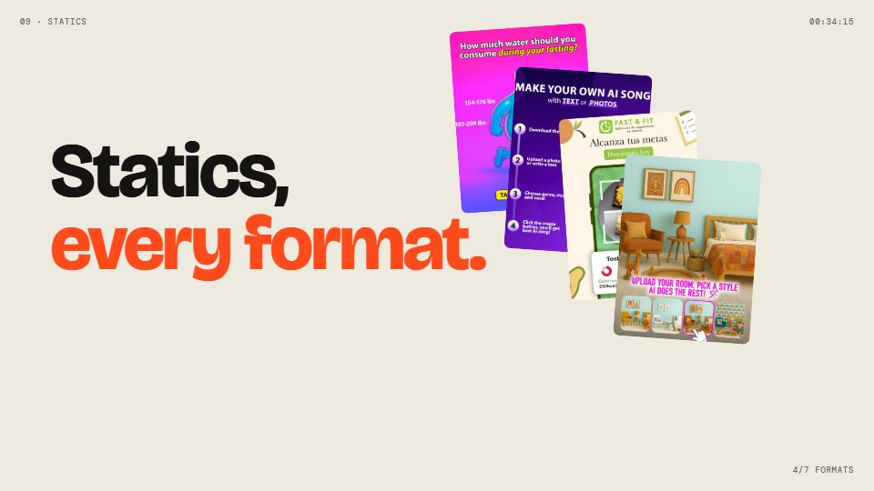</td>
</tr>
<tr>
<td>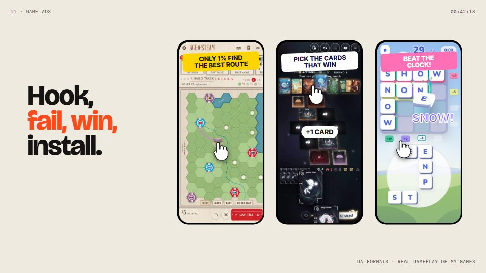</td>
<td>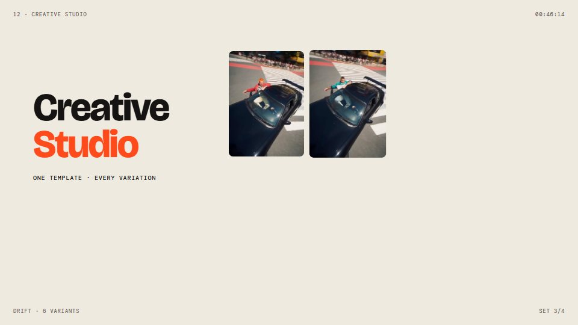</td>
<td>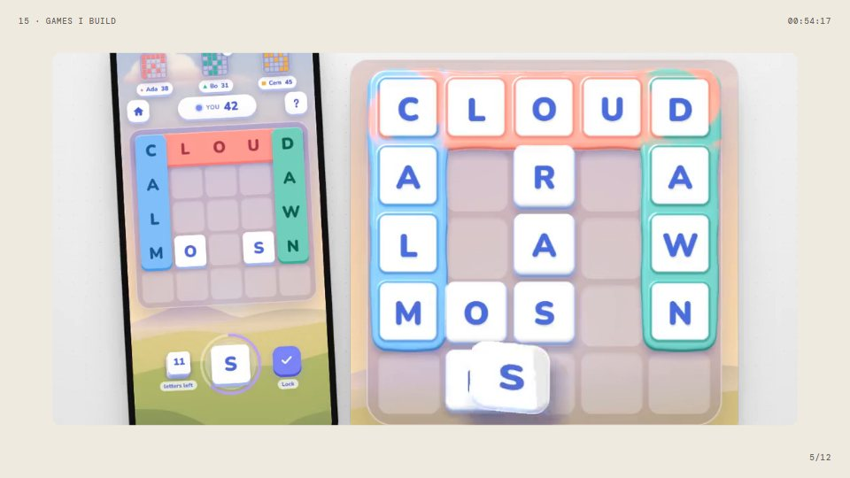</td>
</tr>
<tr>
<td>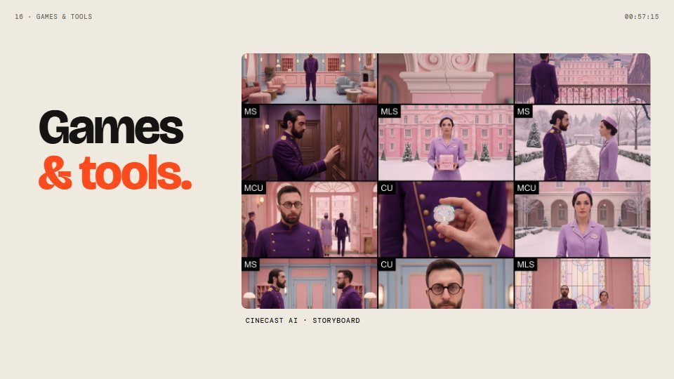</td>
<td>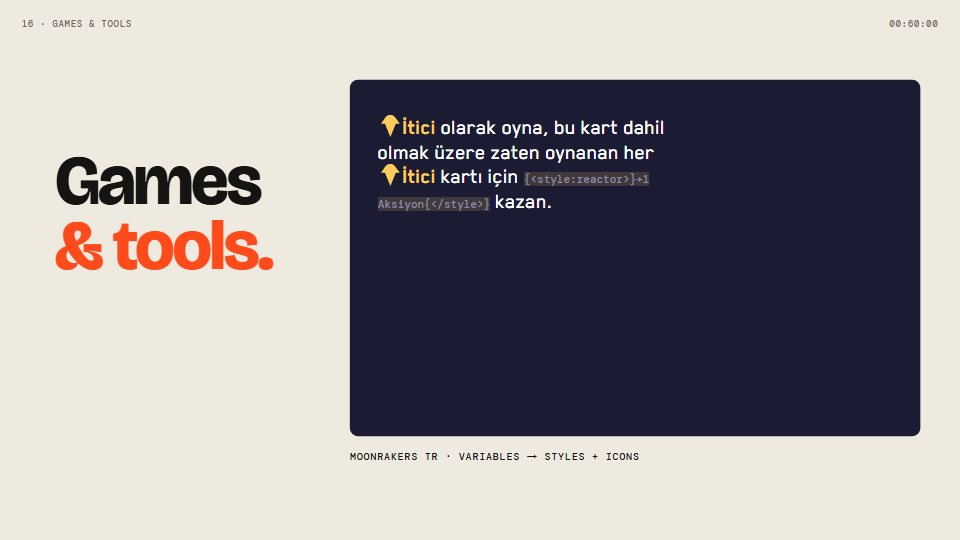</td>
<td>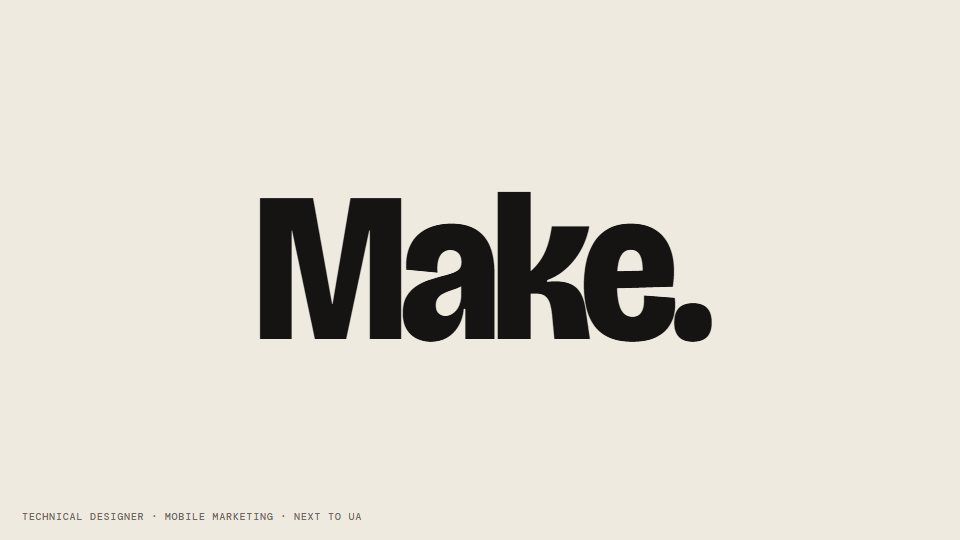</td>
</tr>
</table>

## Two cuts from the same code

`ReelV15` renders at 1920 × 1080 and `ReelV15V` at 1080 × 1920, both 30 fps and 70.3 s, from the same scenes and the same data.

<p>
&nbsp;
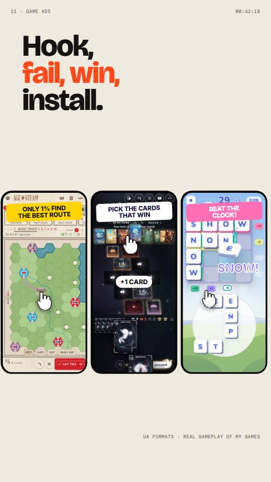&nbsp;
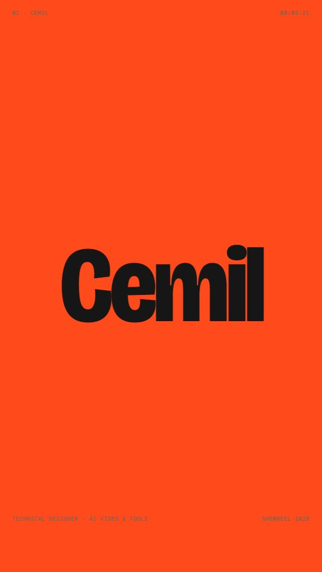
</p>

The reel runs through 20 scenes (`src/ReelV15.jsx`, bottom of the file):
- an opening where Bauhaus shapes turn into the name
- AI trend clips in rows and growing grids, then kinetic type
- ads shown in every ratio and every feed
- the tools I built (Ad Studio, Ad Cloner, Creative Studio, AI Studio) with a scripted cursor clicking through them
- game ads made from real recorded play
- a card system re-rendered from one text table
- the finale and the end card

The visual system:
- a light paper ground
- big kinetic type in Bricolage Grotesque, using its variable width and weight axes
- Anton for stacked lines
- DM Mono for corner labels
- shape-morph wipes on the section cuts: a circle grows and leaves as a rotating rounded square

## The edit, as data

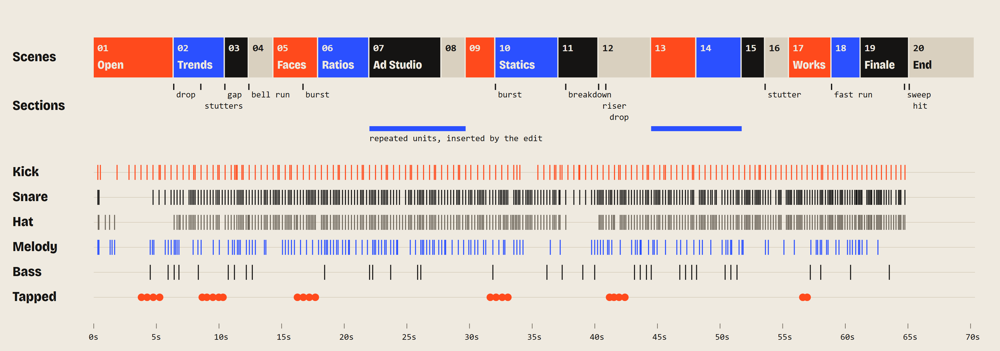

Everything on this chart is read from the data files: the 20 scenes, the music sections, the two units the edit repeats, and every hit per instrument. The [watch page](https://lalimec.github.io/showreel-code/) runs this chart under the video with a playhead and live pulse meters.

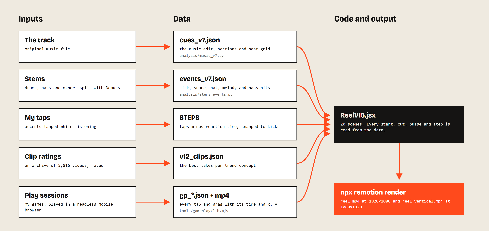

### 1. The music edit and the section map: `src/cues_v7.json`

Written by `analysis/music_v7.py`.

- **`segs`**: which ranges of the original track play where. The two-bar 125-BPM unit and the ~133-BPM unit each play twice more in place, and the track is cut on the downbeat at the sweep.
- **Section times** on the edited timeline: `drop`, `stutter1`–`stutter4`, `gap`, `bells`, `burst1`–`burst4`, `breakdown`, `riser`, `drop2`, `fast`, `sweep`, `impact`, `total`.
- **The beat grid**: `beats`, plus the inserted units `insG` / `insD` with their lengths.

Every scene starts and ends on a cue. For example `<Sc a={Q.drop} b={Q.gap}><Trends /></Sc>` runs the trend scene from the drop to the gap. Change the cue sheet and the whole edit re-times.

### 2. Per-instrument hits: `src/events_v7.json`

Written by `analysis/stems_events.py`. The original track is split into stems with Demucs. The same segment edit is applied to each stem, and onsets are detected per band:

| Layer | Source |
|---|---|
| `kick` | drums stem, below 150 Hz |
| `snare` | drums stem, 180–2500 Hz |
| `hat` | drums stem, above 6 kHz |
| `melody` | other stem |
| `bass` | bass stem |

The scenes read these hits through three small helpers:

| Helper | What it returns | What it drives |
|---|---|---|
| `decay(E.kick, t)` | a pulse that jumps to 1 on each hit and falls off exponentially | zoom, scale, the variable font width, the fisheye |
| `idx(hits, t)` | how many hits have passed | steps: which background colour, how many grid tiles, which word is showing |
| `lastHit` | the most recent hit | |

A few places where you can see it:
- In the opening, the name's letters narrow to 82% width on every kick and spring back to 100%.
- In the faces scene, the cuts follow `E.melody` onsets.
- The trend grid grows on each stutter hit, from 5 × 1 to 7 × 2, 9 × 3 and 11 × 4 tiles:

<p align="center">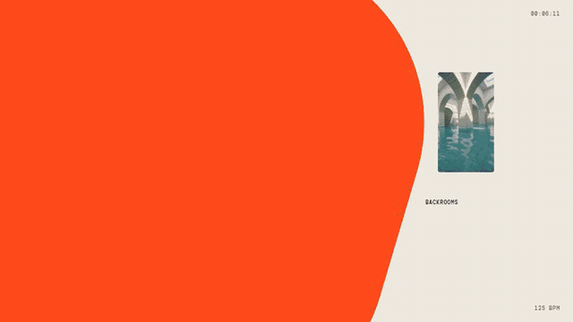</p>

### 3. Hand-tapped accents: `STEPS` in `ReelV15.jsx`

I tapped the moments I wanted the big hits on while listening. The taps are corrected for reaction time and snapped to the nearest detected kick (`snap()`), and they drive the held zoom steps. They're the orange dots on the chart.

### 4. Curated clips: `src/v12_clips.json`

The AI trend clips come from an archive of 5,816 generated videos. The clips were rated, and only the best takes per concept are listed here, grouped by concept. Scenes pick clips by index (`poolClip(i)`, `CLIPS[id].clips`), so a different curation fills the same grids without touching the scene code.

### 5. Recorded gameplay: `src/gp_aos.json`, `gp_ar.json`, `gp_wsv.json`

<p align="center">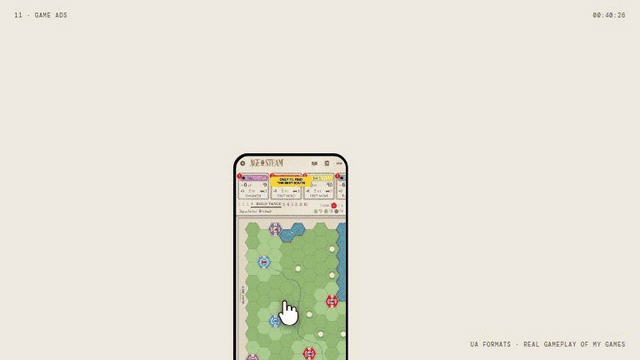</p>

The game ads use real play sessions of my games, recorded in a headless mobile browser with Playwright (`tools/gameplay/lib.mjs`). Every tap and drag is logged with its time, coordinates and a label, and the recording is trimmed and encoded with FFmpeg.

In the reel, `GameAd14` plays each recording sped up by a per-game rate:

| Game | Rate |
|---|---|
| Age of Steam | 4× |
| Aether Realms | 3× |
| WordSquare Versus | 3.2× |

The finger replays every recorded tap and drag at the same rate. It glides to the next recorded point, presses on it, and follows drags along their path. On top run the ad overlays:
- a hook banner
- timed format beats: a FAIL flash with a screen shake, TRY AGAIN, +1 CARD, the words scored in WordSquare, a win flash
- an end card that slides up, with a PLAY FREE button pulsing on the beat

WordSquare also stores the words that fill the square, so every row and column on screen is a real word.

### 6. Layout data: `src/moon_index.json`, `src/bgs_covers.json`

- **`moon_index.json`**: the card atlas for the Moonrakers card wall: how many cards, columns, and tall and square rows, with cell sizes. One tile component cuts any card from it.
- **`bgs_covers.json`**: the cover list for the Board Game Salon mosaic.

### 7. Tables inside the scene code

| Table | What it holds |
|---|---|
| `P` | the palette |
| `RAT` | the ratios an ad is shown in: 9:16, 4:5, 1:1 and 16:9 |
| `ADS` | which rendered ad and caption appears where |
| `TR5` / `POOL` / `VSETS` | which concepts fill which scene |
| `WIPES` | the cue, colour and origin of each shape-morph wipe |

## Run it yourself

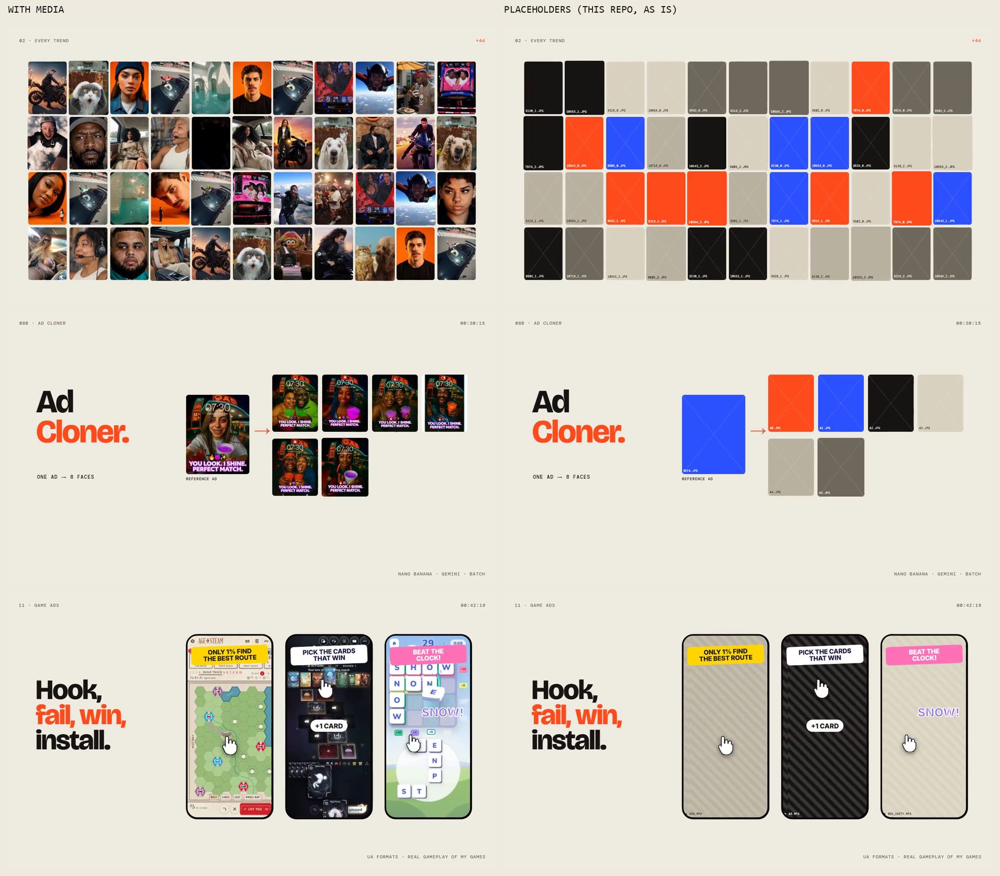

Every clip, still, screenshot, atlas and the soundtrack go through one module, `src/media.jsx`. By default it runs in placeholder mode:
- **Video slots** are drawn as striped, moving blocks.
- **Still slots** are drawn as crossed blocks.
- **Labels:** each block is labelled with the file it stands for and coloured by its name, so the same clip always gets the same colour.
- **Soundtrack:** `public/audio/events_drums.wav`, generated by `analysis/drums_from_events.py`: a drum machine played from `events_v7.json`, plus the edit's effects from `cues_v7.json` (intro swell, drops, stutters, the bell run, bursts, riser, sweep and final impact). Every sound you hear is a cue the scenes react to.

Timing, layout, type, the cursor and every overlay are untouched. Here are the same moments with media and from this repo as it is:

<table>
<tr><th>With media</th><th>This repo, no media</th></tr>
<tr><td></td><td>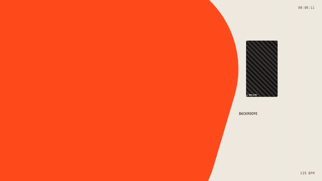</td></tr>
<tr><td></td><td>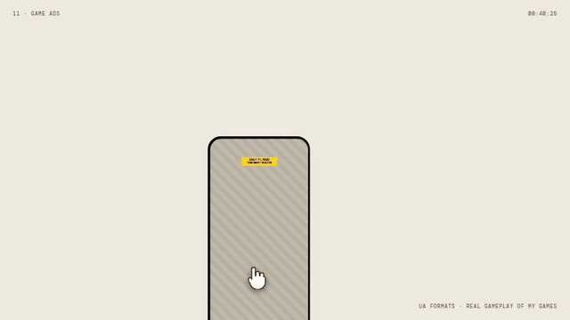</td></tr>
</table>

### In the browser

The watch page's *Live code, no media* mode isn't a video. It runs the compositions themselves with [`@remotion/player`](https://www.remotion.dev/docs/player). `web/player.jsx` mounts `ReelV15` or `ReelV15V` in a `<Player>`, and esbuild bundles it into `docs/live/player.js`. The page reads the player's current frame to drive the same timeline and pulse meters it uses for the video.

```bash
npm run build:web         # web/player.jsx -> docs/live/player.js
```

### Rendering

Clone it and it renders:

```bash
npm install
npm run render            # ReelV15  -> out/reel.mp4           (placeholders + the event drum track)
npm run render:vertical   # ReelV15V -> out/reel_vertical.mp4
npm run stills -- 6.28 6.48 12.38   # PNG stills of both cuts at those seconds, for checking cuts at full size
npm run studio            # Remotion Studio, to scrub the timeline
```

## Export with the real media

With the media in `public/` (layout below), turn placeholders off:

```bash
npx remotion render src/index.js ReelV15 out/reel.mp4 --props='{"placeholder":false}'
```

This renders H.264 MP4 with the edited track from `public/audio/music_v7.wav`.

The audio and the event data are made before rendering:

```bash
python analysis/music_v7.py        # edit the track -> public/audio/music_v7.wav + src/cues_v7.json
demucs public/audio/music.mp3      # stems of the original track -> music/stems/{drums,bass,other}.wav
python analysis/stems_events.py v7 # cut the stems with the same segment list, detect hits -> src/events_v7.json
```

## Media (not included)

`staticFile()` paths the code expects under `public/`:

```
public/
  audio/music_v7.wav          the edited track
  fonts/                      Bricolage Grotesque (OFL) and other local fonts
  v/, v12/                    curated AI clips and rendered ads (mp4)
  i/                          stills, posters, the fisheye displacement map
  assets2/, assets3/          tool screenshots, gameplay recordings, card atlases, covers
```

Included: `public/fonts/brico-latin.woff2` (Bricolage Grotesque, SIL Open Font License, see `public/fonts/OFL.txt`) and the generated drum track. The Moonrakers scene uses Blender Pro, which isn't included; it falls back to Bricolage.

`docs/` holds the watch page (GitHub Pages): a 720p render with media, the live player bundle, the cue and event data, the music, the placeholder font and the generated track under `docs/assets/`, and the images above. The page has one clock, the music: the video and the live player both follow it, so you can switch between them, or move the compare line across both, without a jump.

Built with Remotion 4, React 18, librosa, Demucs, Playwright and FFmpeg. Code written with Claude Code.
